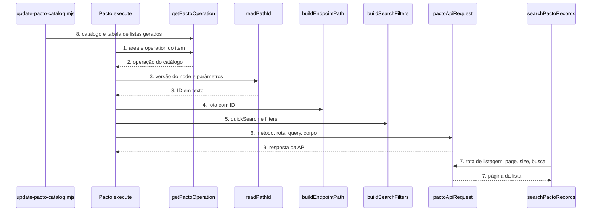

# Pacto: node-cli 0.55 e campos guiados (versão 2 do node)

**Approved**: 2026-11-06 - user: "Aprovo com antecedência (Recomendado · Jev 0,96)"

> Build this with **tlc-implement**. Every criterion becomes a check with a proof; nothing under
> the open questions is settled while building.

## Problem

O pacote `n8n-nodes-pacto` 1.0.3 compila com `tsc` + `gulp` e usa o plugin de lint 0.23. O `n8n-node lint` do `@n8n/node-cli` 0.55.5, que a guideline de verificação do n8n exige, acusa 13 erros neste código (medido em worktree descartável sobre a `master`): 6 `any` explícito, 1 import sem uso, 1 categoria `AI` inválida em `Pacto.node.json`, e 5 de texto e flag do parâmetro `operation` e do parâmetro `returnAll`. O pacote não tem teste, não tem workflow de CI e publica com `npm publish`, que o token "stage only" do dono recusa.

Quem usa o node digita à mão o ID de cada registro (aluno, cliente, produto, plano, aula, aparelho, ativo do patrimônio). A API da Pacto tem a rota de listagem de cada um, mas o node mostra um campo de texto: a pessoa sai do n8n para achar o código. Filtrar uma lista exige escrever JSON à mão no campo `filters`. Além disso, o catálogo `catalog.generated.ts` (3.533 operações, 408 áreas, gerado em 17/07/2026) ficou velho: a documentação viva de 06/11/2026 tem 4.620 operações, e rodar o gerador de hoje sem cuidado tira 323 operações e 26 áreas que o 1.0.3 publica e põe `�` no nome de 22 áreas.

Quando isso sair: o lint oficial passa com 0 erros, e em node novo as operações que têm lista mostram uma lista pesquisável com a opção de colar o ID. As operações com filtro de busca mostram um campo "Busca Rápida". Workflows salvos continuam funcionando sem edição.

## Shape

Reutiliza `pactoApiRequest`, `buildEndpointPath`, o `resourceMapper` e o gerador `update-pacto-catalog.mjs`, que passa a emitir também a tabela de listas; as regras que mudam o resultado (ler o ID na versão 1 ou 2, montar a busca, decidir a próxima página) ficam em funções puras de `helpers/` que os testes alcançam pelo `execute` e pelo `listSearch` do node.

1. entra o item do workflow -> `Pacto.execute` (exists) - lê `resource`, `operation` e `fields`, chama `getPactoOperation`
2. `getPactoOperation` (exists) - devolve a operação do catálogo, inclusive as marcadas `legacy`
3. `readPathId` (new) - na versão 1 lê `path__<nome>` do `fields`; na versão 2 lê o `value` do `recordId` e remove espaços das pontas; devolve o mesmo texto nos dois casos
4. `buildEndpointPath` (exists) - monta a rota com o ID codificado
5. `buildSearchFilters` (new) - na versão 2, junta o campo `quickSearch` ao JSON de `query__filters`
6. `pactoApiRequest` (exists) - chama a API com `timeout` de 30000 e a credencial `pactoApi`
7. `searchPactoRecords` (new) - o editor chama com texto e página; lê a lista da operação em `PACTO_LOOKUPS`, chama `pactoApiRequest` na rota de listagem e devolve `{ results, paginationToken }`
8. `update-pacto-catalog.mjs` (exists) - lê a documentação viva, preserva o 1.0.3 e grava o catálogo e a tabela de listas (door 2)
9. out: a resposta da API como itens do n8n, igual ao 1.0.3

**Changes underneath**

| Front | What changes |
| --- | --- |
| domain | a área e a operação mantêm o valor do 1.0.3; operação ausente da documentação viva ganha `legacy: true` e some só da lista da versão 2 (door 1) |
| stored data | nothing to migrate: workflow salvo guarda `typeVersion` 1 e continua lendo `fields` |
| readers | o editor do n8n mostra `recordId` e `quickSearch` só em node novo e só nas operações que têm lista ou filtro; o README e o `Pacto.node.json` mudam de texto |
| toolchain | `package.json`, `eslint.config.mjs`, `tsconfig.json`, `gulpfile.js` e os workflows passam ao padrão do template do node-cli 0.55.5 |

Data: none - o node não guarda dado; ele repassa a requisição para a API Pacto e devolve a resposta.

## Surface

| Route | In | Out | Status | Who |
| --- | --- | --- | --- | --- |
| node `pacto` versão 2 | `recordId` como `{ mode: 'list' ou 'id', value }`, `quickSearch` em texto, `fields` e `returnAll` | a mesma resposta da versão 1 | `200`; `401` com Secret Key inválida vira `NodeApiError`; demais `4xx` e `5xx` também | quem tem credencial Pacto válida; sem ela a API devolve `401` |
| node `pacto` versão 1 | `fields` e `returnAll`, iguais ao 1.0.3 | igual ao 1.0.3 | `200`; `401` com Secret Key inválida vira `NodeApiError`; demais `4xx` e `5xx` também | workflows salvos com credencial Pacto válida; sem ela a API devolve `401` |
| `searchPactoRecords` | texto de busca e página | `{ results: [{ name, value }], paginationToken? }` | `200`; `401` com Secret Key inválida vira `NodeApiError` | o editor do n8n com credencial Pacto válida; sem ela a API devolve `401` |

## Landing

| One-way door | Literal shape | Alternative rejected |
| --- | --- | --- |
| valor da área e chave da operação | o catálogo mantém todo par `area` + `key` do 1.0.3; operação sumida da documentação ganha `legacy: true`; área com `�` volta ao valor do 1.0.3 (AD-009) | aceitar a documentação viva como está: 323 operações e 26 áreas somem e 22 áreas mudam de nome, e todo workflow salvo nelas quebra |
| formato de `lookups.generated.ts` | `PACTO_LOOKUPS: Record<"<area>:<key>", { listPath, valueField, labelField, search: { kind: 'query' ou 'filters', name } ou null, pagination: { page: 'page', size: 'size' } }>`, só para rota com `page` e `size` na documentação | adivinhar rota por nome de campo (`alunoId` vira alunos): a documentação não diz que `alunoId` é o `id` de `/psec/alunos`, e uma rota errada mostraria registros de outra entidade |
| nome do parâmetro novo | `recordId` (Resource Locator) e `quickSearch` (string), só com `@version` 2 | reusar `fields`: o `resourceMapper` não aceita Resource Locator por campo (AD-007) |
| versão do node e do pacote | `version: [1, 2]`, `defaultVersion: 2`, pacote `1.1.0` | `VersionedNodeType` ou `2.0.0`: nenhum workflow salvo quebra, então não há motivo de major |

- Nothing else in this change is hard to reverse

## Criteria

### S1: toolchain do node-cli 0.55.5 e entrega (P1)

O pacote compila, passa no lint oficial, roda os testes e publica pelo fluxo "stage only".

**Acceptance Criteria**

1. WHEN `npm run lint` roda THEN `n8n-node lint` SHALL sair com código 0 e imprimir 0 erros (hoje são 13 na `master`)
2. WHEN `npm run build` roda THEN o sistema SHALL sair com código 0 e gerar `dist/nodes/Pacto/Pacto.node.js`, `dist/credentials/PactoApi.credentials.js` e os ícones `pacto.svg` e `pacto.dark.svg` ao lado do node
3. The `package.json` SHALL ter `"build": "n8n-node build"`, `"lint": "n8n-node lint"`, `"n8n.strict": true`, `@n8n/node-cli` `0.55.5` em `devDependencies`, nenhum campo `dependencies`, nenhuma referência a `gulp`, o campo funding com tipo individual e a URL buymeacoffee.com/qTny0AzFXS e `"update:catalog"` preservado
4. The `package.json` SHALL ter `n8n-workflow` `^2.46.5` em `devDependencies` e `peerDependencies` `{ "n8n-workflow": "*" }`, e o `package-lock.json` SHALL resolver `n8n-workflow` na versão 2.46.5 ou mais nova
5. WHEN um Pull Request abre ou a `master` recebe push THEN o workflow de CI SHALL rodar `npm ci`, `npm run lint`, `npm test` e `npm run build` com `node-version: 24`
6. WHEN a tag `v1.1.0` chega ao GitHub THEN o workflow de publicação SHALL usar a mesma `node-version` do workflow de CI, validar que a tag é igual a `v` + versão do `package.json`, rodar lint, test e build, e publicar com `npx -y npm@12.2.2 stage publish --provenance --access public` com `RELEASE_MODE: 'true'` no passo; o `on:` SHALL incluir `workflow_dispatch`
7. WHEN `npm test` roda THEN o sistema SHALL compilar e rodar `node --test test/*.test.cjs` com saída `# fail 0`
8. The `README.md` SHALL ter selo e seção "Apoie o projeto", índice, Funcionalidades, Instalação, Credenciais, Nós e Operações, Usar como Tool de Agente de IA, exemplos, Desenvolvimento, Compatibilidade, Recursos, Publicação, Versões, Suporte e Licença, e SHALL dizer o número de operações e áreas do catálogo regenerado (sem o 3.499 do 1.0.3); como o node não tem trigger, não tem seção Trigger

### S2: versão 1 e catálogo regenerado sem perda (P1)

Workflow salvo no 1.0.3 envia a mesma requisição, e o catálogo novo não perde nada que o 1.0.3 publica.

**Acceptance Criteria**

1. WHEN o `execute` roda com `typeVersion` 1, `resource` `Clientes`, `operation` `GET:/psec/alunos/{id}` e `fields.value` `{ path__id: '42' }` THEN o sistema SHALL chamar `GET /psec/alunos/42` na base apigw.pactosolucoes.com.br com a credencial `pactoApi` e `timeout` 30000
2. WHEN o `execute` roda com `typeVersion` 1, `returnAll` verdadeiro e uma API que devolve 100 itens na página 0, 100 na página 1 e 30 na página 2 THEN o sistema SHALL pedir `page` 0, 1 e 2 com `size` 100 e devolver 230 itens
3. The node SHALL listar, para `@version` 1, os parâmetros `resource` (options), `operation` (options), `fields` (resourceMapper) e `returnAll` (boolean) com o mesmo `name` e o mesmo `type` do 1.0.3
4. WHEN `npm run update:catalog` roda contra a documentação viva THEN todo par `area` + `key` do 1.0.3 SHALL existir no catálogo gerado
   - par ausente da documentação (323 hoje) → presente com `legacy: true`; par presente → sem `legacy`
5. IF o nome de uma área na documentação viva tem `�` ou U+FFFD THEN o gerador SHALL trocá-lo pelo valor da área do 1.0.3 que casa com o nome trocando cada trecho `�` por qualquer caractere
   - `Arm�rio` → `Armário` (casa com um valor do 1.0.3); sem valor que case → o gerador sai com código 1 e lista o nome
6. WHEN o catálogo gerado carrega THEN `PACTO_AREA_OPTIONS` SHALL ter 0 valores com `�` ou U+FFFD e todo valor de área do 1.0.3 que ainda tem operação SHALL estar nele
7. WHEN a versão 2 lista as operações de uma área THEN `getPactoOperations` SHALL omitir as com `legacy: true`; WHEN a versão 1 lista THEN SHALL incluí-las

### S3: IDs guiados na versão 2 (P1)

Em node novo, a operação com lista mostra o ID como lista pesquisável.

**Acceptance Criteria**

1. WHEN alguém adiciona o node a um workflow novo THEN o sistema SHALL criá-lo com `typeVersion` 2
2. The gerador SHALL emitir uma entrada em `PACTO_LOOKUPS` para toda operação cujo primeiro parâmetro de caminho `{p}` tem uma rota `GET` na base (o trecho antes de `{p}`) com os parâmetros `page` e `size`, em que o item da resposta tem uma propriedade de nome `p` e uma propriedade `nome`, `descricao`, `name` ou `titulo`; hoje são 132 operações em 37 bases, e o gerador SHALL imprimir a lista das bases descartadas com o motivo (158 hoje)
3. The gerador SHALL sair com código 1 e dizer a rota IF uma entrada aponta para uma rota que não existe na documentação
4. WHEN o node mostra uma operação com entrada em `PACTO_LOOKUPS` na versão 2 THEN o sistema SHALL mostrar o parâmetro `recordId` como `resourceLocator` com os modos `list` (padrão, `searchable: true`, `searchListMethod: 'searchPactoRecords'`) e `id`, e o `resourceMapper` SHALL omitir o campo `path__
` dessa operação; na versão 1 e nas operações sem entrada, o `resourceMapper` mantém o campo
5. WHEN o `execute` roda com `typeVersion` 2, `operation` `GET:/psec/alunos/{id}` e `recordId` `{ mode: 'list', value: '42' }` THEN o sistema SHALL chamar `GET /psec/alunos/42`
6. WHEN o `execute` roda com `typeVersion` 2 e `recordId` `{ mode: 'id', value: ' 42 ' }` THEN o sistema SHALL chamar `GET /psec/alunos/42`
7. IF `recordId` chega com `value` vazio THEN o sistema SHALL lançar `NodeOperationError` com a mensagem `Escolha um registro na lista ou cole o ID` e `itemIndex` 0
8. WHEN o editor chama `searchPactoRecords` na operação `GET:/psec/alunos/{id}` com o texto `ana` e sem página THEN o sistema SHALL chamar `GET /psec/alunos` com `page` 0, `size` 20 e `filters` `{"quicksearchValue":"ana"}`, com `timeout` 30000, e devolver cada item como `{ name: <nome>, value: <id em texto> }`
    - item `{ id: 42, nome: 'Ana Silva' }` → `{ name: 'Ana Silva', value: '42' }`; item sem `nome` → `{ name: '42', value: '42' }`
9. WHEN a rota de listagem tem o parâmetro `quicksearchValue` em `query` (como `/produtos` e `/planos`) THEN `searchPactoRecords` SHALL enviar a busca em `qs.quicksearchValue`; WHEN só `filters` cita `quicksearchValue` THEN em `filters`; WHEN nenhum dos dois THEN SHALL buscar a página e filtrar no node pelo texto, sem diferenciar maiúscula e acento
10. WHEN a resposta traz `last: true`, ou menos itens que `size`, ou `page + 1 >= totalPages` THEN `searchPactoRecords` SHALL devolver sem `paginationToken`; senão SHALL devolver `paginationToken` igual à página seguinte em texto, e SHALL pedir uma página por chamada
    - 20 itens, `last: false`, página 0 → `paginationToken: '1'`; 12 itens → sem token; `totalPages: 1` → sem token
11. WHEN a resposta traz o número da página (`number` ou `page`) THEN o próximo `paginationToken` SHALL ser esse número + 1, e não o número pedido + 1
12. IF a rota de listagem devolve `401` THEN `searchPactoRecords` SHALL lançar `NodeApiError`
13. WHEN o `execute` roda com `typeVersion` 2 e `returnAll` verdadeiro THEN o sistema SHALL paginar como na versão 1 (critério 2 do S2)

### S4: Busca Rápida nos filtros (P2)

Quem filtra uma listagem escreve o texto num campo, não JSON.

**Acceptance Criteria**

1. WHERE a operação tem o parâmetro `filters` cuja descrição cita `quicksearchValue` (199 parâmetros hoje) THEN o node na versão 2 SHALL mostrar o parâmetro `quickSearch` (string) com o título `Busca Rápida`
2. WHEN `quickSearch` é `silva` e `query__filters` está vazio THEN o sistema SHALL enviar `filters` `{"quicksearchValue":"silva"}`
3. WHEN `quickSearch` é `silva` e `query__filters` é `{"situacoesEnuns":["AT"]}` THEN o sistema SHALL enviar `filters` `{"situacoesEnuns":["AT"],"quicksearchValue":"silva"}`
4. IF `query__filters` não é JSON de objeto THEN o sistema SHALL lançar `NodeOperationError` com a mensagem `O campo Filters precisa ser um objeto JSON`
5. WHEN `quickSearch` está vazio THEN o sistema SHALL enviar `filters` exatamente como o usuário escreveu

### S5: lançamento 1.1.0 (P2)

A versão nova chega ao npm com provenance, aprovada pelo dono.

**Acceptance Criteria**

1. The `package.json` SHALL ter `"version": "1.1.0"` e a seção Versões do README SHALL listar a migração para node-cli, a versão 2 do node, os IDs guiados, a Busca Rápida e a preservação das 323 operações
2. WHEN a tag `v1.1.0` chega ao GitHub THEN o workflow de publicação SHALL deixar `n8n-nodes-pacto@1.1.0` na fila "Staged Packages" do npm; depois da aprovação do dono, `npm view n8n-nodes-pacto version` SHALL devolver `1.1.0`

## Out of scope

| Excluded | Why |
| --- | --- |
| Seletor para ID dentro do corpo ou da query (`alunoId`, `professorId`, `codigoCliente`: cerca de 100 campos) | Esses campos vivem no `resourceMapper`, que não aceita Resource Locator por campo; a documentação também não diz de qual lista cada um vem |
| Segundo parâmetro de caminho na mesma rota | O `recordId` cobre o primeiro; o resto continua no `resourceMapper` |
| Lista para as 158 bases descartadas e para rotas com `paginadorDTO` no lugar de `page` e `size` | A documentação não confirma o nome do ID ou do rótulo, ou o formato da paginação; entram quando o dono confirmar a rota |
| Formato dos 616 campos de data sem descrição | A documentação não diz o formato; o node mantém o envio atual |
| Campo de corpo em array (2.350) e de texto livre que a documentação não tipa | Sem tipo na documentação, o node não adivinha |
| Novas operações ou rota própria além do catálogo | O pedido é sobre o preenchimento dos campos |
| Trigger | A API Pacto não tem webhook documentado nesta especificação |

## Assumptions

| Assumption | Chosen default | Rationale | Confirmed? |
| --- | --- | --- | --- |
| A página inicial da API é 0 ou 1 | O `searchPactoRecords` pede `page` 0 e segue o número que a resposta devolve (critério 11 do S3) | A documentação dá exemplo 1 em `/psec/alunos` e 0 em `/psec/colaboradores`; o `returnAll` do 1.0.3 já começa em 0 | n |
| O valor da lista é o campo com o mesmo nome do parâmetro de caminho (`id` para `{id}`, `codigo` para `{codigo}`) | Só a base cujo item tem esse campo vira lista | É a única ligação que a documentação sustenta; sem ela a base fica descartada e listada | n |
| Tamanho da página do seletor | 20 itens | Mostra uma lista curta no editor e pede uma página por vez | n |
| Idioma de rótulos e mensagens | PT-BR em Title Case sem preposição maiúscula, como o resto do node | O 1.0.3 já escreve em PT-BR | n |
| As 323 operações que a documentação viva removeu | Ficam no catálogo com `legacy: true`, visíveis só na versão 1 (AD-009) | Workflow salvo guarda área e chave da operação; o dono decidiu que workflow salvo não quebra. Jev 1,00 contra remover 0,00 | y - user: "Aprovo com antecedência (Recomendado · Jev 0,96)" |
| Seletor para ID de query e de corpo | Fora deste lançamento (ver Out of scope) | Vivem no `resourceMapper`, que não aceita Resource Locator por campo | y - user: "Aprovo com antecedência (Recomendado · Jev 0,96)" |
| Número de operações do README | Sai do catálogo regenerado no dia | O 3.499 do 1.0.3 é do catálogo de 17/07/2026 | n |
| A documentação viva não muda a chave de uma operação que o 1.0.3 publica sem aviso | O gerador falha só se perder um par que não consegue marcar `legacy` | A chave é `METHOD:path`, o gerador a monta sozinho | n |

**Open questions:** none - all resolved or logged above.

## Differences from the source

None - the product matches the source

## Sources

- Pedido do dono, 06/11/2026: "atualizar e melhorar todos os nodes n8n de acordo com a nova versão, deixar mais fácil e intuitivo o preenchimento dos campos, sempre consultar a doc da ferramenta do node" - binding - escopo do trabalho
- Documentação oficial da Pacto, https://api-docs.pactosolucoes.com.br/ (OpenAPI 3.0.1 lida pelo gerador, 4.620 operações em 06/11/2026; o Context7 não tem a biblioteca) - binding - rotas de listagem, `page`, `size`, `filters`, `quicksearchValue`
- Plano do RD Station CRM em `Rd Station Node/.specs/features/node-cli-campos-v2/plan.md` - binding - estrutura, versão leve e lições da revisão
- Template e guias do `@n8n/node-cli` 0.55.5 e UX guidelines do n8n - binding - toolchain, versão leve, Resource Locator
